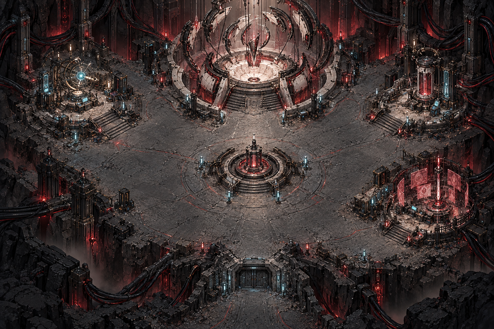

# 零域协议 / Zero Domain Protocol

> 一个正在制作的 Godot 4 科幻剧情 RPG。当前为**半成品公开试玩版**，可以从主菜单开始，并体验多个已闭环任务。



## 已实现内容

- SITE OMEGA 基地探索、人物面板、任务指引与存档。
- 《静默回路》：终端、单次补给、中继二选一、难度变化、残骸回收与返回沈砚汇报。
- 《回声之外》：多区域外勤、可选救援、修桥、测绘箱与多入口解法。
- 《灰烬遗言》与弥珀支线《为活者调弦》：真实性校验、姓名片归还、三点共振、0/30/80 信赖与后续战斗支援。
- 蚀日掠夺团章节：裘盛三局赌战、闻缄镜中幻境与控魂战、岳沉戈双形态终战。
- 战斗结算、受伤立绘差分、低血量战损状态、敌人蓄力预警与防御反击。
- 真结局授衔仪式与闻缄战败 BE 支线。

## 运行方法

1. 安装 [Godot 4.7](https://godotengine.org/download/) 或兼容的 Godot 4.x 版本。
2. 克隆或下载本仓库。
3. 在 Godot 项目管理器中导入根目录的 `project.godot`。
4. 等待首次素材导入完成，按 `F5` 或点击右上角运行。

Godot 第一次导入约 300MB 图片时需要等待一会儿，这是正常现象。

## 操作

| 按键 | 功能 |
| --- | --- |
| `WASD` / 方向键 | 移动 |
| `E` | 交互、对话 |
| `C` | 角色、装备与任务面板 |
| `M` | 地图 |
| `Esc` | 返回或关闭面板 |
| `1` / `2` / `3` | 战斗中攻击、技能和防御 |

## 自动化测试

项目含有15个无窗口测试脚本。例如：

```bash
/Applications/Godot.app/Contents/MacOS/Godot --headless --path . --script res://tests/test_silent_circuit.gd
/Applications/Godot.app/Contents/MacOS/Godot --headless --path . --script res://tests/test_mi_po_quest.gd
```

Windows 或 Linux 上将命令开头替换为本机的 Godot 可执行文件即可。

## 已知的半成品限制

- 部分立绘、动画与音效仍是占位或首版素材。
- 某些剧情以静态 CG 和对话呈现，尚未完成全部过场动画。
- 数值与 Boss 难度仍需要更多真实玩家测试。
- 暂无正式发行包；当前需要使用 Godot 编辑器运行。

## 参与贡献

欢迎通过 Issue 反馈 Bug、剧情节奏、数值平衡和新任务建议。提交代码时请尽量保持现有 GDScript 风格，并为任务状态、存档迁移或战斗逻辑补充相应测试。

## 许可

- 代码：[MIT License](LICENSE)
- 美术、角色与剧情素材：见 [ASSET_LICENSE.md](ASSET_LICENSE.md)

项目使用 AI 辅助编程和美术生成，并由项目作者筛选、组合与维护。
